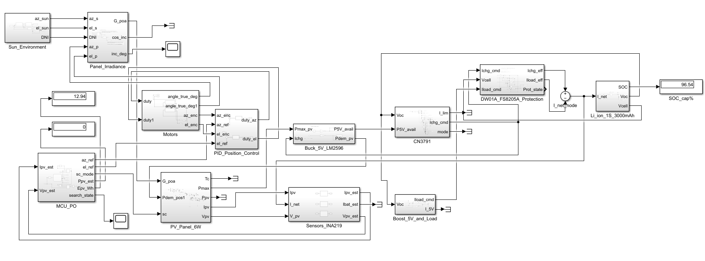

# Dual-Axis Solar Tracker: A Model-Based Design Study in Simulink


## Abstract

This repository contains a system-level Simulink model of a small dual-axis solar tracker with battery charging. The reference system comprises a 6 W photovoltaic (PV) panel, a single-cell (1S) Li-ion battery, and a 5 V load. The work follows a model-based design (MBD) approach and is currently at the **model-in-the-loop (MIL)** stage. Controller code generation is planned as a later step.

## System Overview



*Figure 1. Top-level model. Signal flow runs from the sun environment and panel irradiance (left), through the PV panel and the buck stage, to the CN3791 charger, the DW01A/FS8205A protection, the 3000 mAh 1S Li-ion model, and the boost stage with its load (right). The position-control loop (motors, encoders, PID) and the sensing chain (INA219 over I2C) are shown below the irradiance path.*

## Methodology

Two constraints govern the development process:

1. **Library-only implementation.** Models are built exclusively from Simulink library blocks. MATLAB Function blocks and hand-written code are not used.
2. **Verify-then-integrate.** Each subsystem is compared against independently computed reference values before it is connected to the rest of the model.

## Implemented Subsystems

| # | Subsystem | Description | Reference check |
|---|-----------|-------------|-----------------|
| 1 | Solar geometry | Hour angle, solar elevation, azimuth, and a direct normal irradiance (DNI) model with a cloud event | Elevation at solar noon: 54.73° (latitude 30.97° N, early October) |
| 2 | Incidence and irradiance | Incidence angle and plane-of-array (POA) irradiance | Hand calculation |
| 3 | PV model | Single-diode model with a vectorized 200-point I–V sweep | Maximum power of about 4.8 W at solar noon |
| 4 | Power chain | 5 V buck stage; CC/CV charger with pre-charge and recharge hysteresis; DW01A-style protection (OV/UV/OC); 3 Ah Li-ion state-of-charge (SOC) model; boost stage with load profile | Subsystem-level checks |
| 5 | Position control | Motor model (dead zone, first-order lag, travel limits); 12-bit encoder quantization; discrete PID with anti-windup | Step response |
| 6 | Current and voltage sensing | INA219 model with I2C readout: shunt-voltage and bus-voltage registers, 12-bit conversion, and I2C polling delay | Current resolution of 10 µV / R_shunt per count (100 µA for an assumed 0.1 Ω shunt); bus-voltage resolution of 4 mV |

### Notes on the reference values

- **Solar elevation.** At solar noon the elevation is
  `α = 90° − |φ − δ|`,
  where φ is the latitude and δ the solar declination. For φ = 30.97° N, α = 54.73° corresponds to δ ≈ −4.3°, which is consistent with early October.
- **Current-sensing resolution.** The INA219 reports the shunt voltage with a fixed step of 10 µV per count, so the current step is `ΔI = 10 µV / R_shunt`. For an assumed R_shunt = 0.1 Ω this gives 100 µA per count. The bus voltage is reported with a 4 mV step. Two devices (PV and battery) require distinct I2C addresses.

## Roadmap

- [x] Solar geometry and irradiance
- [x] PV model
- [x] Power chain (buck, charger, protection, battery, boost)
- [x] Position control and sensing chain
- [ ] Sensor noise models. The INA219 offset, the selected conversion time and averaging setting, and the I2C read latency affect the detectability of power changes in the tracker.
- [ ] Perturb-and-observe (P&O) controller implemented as a Stateflow chart. Here P&O perturbs the **panel angle** and observes the resulting power. It is not an electrical MPPT of the converter duty cycle.
- [ ] Time-compressed 12-hour comparison of three cases: fixed panel, P&O tracker, and ideal tracker.
- [ ] Controller code generation (later stage).

## Repository Structure

```text
.
├── models/        % Simulink models (.slx)
├── scripts/       % Reference calculations and verification scripts
├── data/          % Reference values and simulation outputs
├── docs/          % Figures and notes
└── README.md
```

> Adjust the folder names above to match the actual repository layout.

## Requirements

- MATLAB and Simulink (specify the release used)
- Stateflow (for the planned P&O controller)

## Usage

1. Clone the repository.
2. Open MATLAB and set the repository root as the current folder.
3. Open the model in `models/` and run the verification scripts in `scripts/`.

## Limitations

- The study is simulation-only. No hardware validation has been performed.
- The I2C link is modelled as a fixed read latency with register quantization. Bus faults and NACKs are not modelled.
- Maximum PV power depends on the assumed irradiance and cell temperature, and is not quoted at standard test conditions (STC).

## Feedback

Comments are welcome, particularly from practitioners with experience in P&O tracking algorithms and small-scale battery management systems. Please open an issue or a discussion.

## Citation

If you use this work, please cite the repository:

```bibtex
@misc{dual_axis_tracker_simulink,
  title  = {Dual-Axis Solar Tracker: A Model-Based Design Study in Simulink},
  author = {Abdelrahman Hesham},
  year   = {2026},
  url    = {<repository URL>}
}
```

## License

Specify a license, for example MIT.
