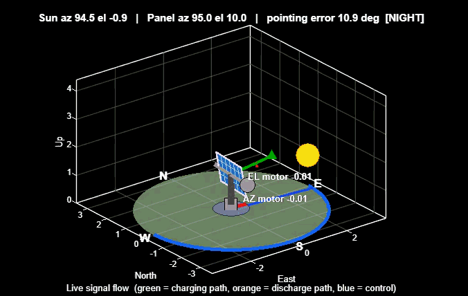

# ☀️ Dual-Axis Solar Tracker: A Model-Based Design Study in Simulink

[](https://www.mathworks.com/)
[-blue?style=for-the-badge)](#roadmap)
[](#roadmap)
[](#license)

---

## 📌 Abstract

This repository presents a comprehensive, system-level **Simulink** implementation of a small dual-axis photovoltaic (PV) solar tracker integrated with a battery management and power supply system. 

The reference hardware architecture features:
* **PV Panel:** 6 W photovoltaic module
* **Energy Storage:** Single-cell (1S) 3000 mAh Li-ion battery
* **Payload:** 5 V regulated load supply

Following a rigorous **Model-Based Design (MBD)** methodology, the project is currently at the **Model-in-the-Loop (MIL)** verification stage. Automated controller code generation (C/C++) is planned for subsequent phases.

---

## 🎥 System Simulation & Animation

<p align="center">
  
</p>

> **Figure 1:** *3D spatial visualization of the solar tracker system. The panel continuously adjusts Azimuth and Elevation angles relative to the sun position while dynamically transmitting live charging/discharging signal flows and diagnostic telemetry.*

---

## 📐 System Architecture

<p align="center">
  
</p>

> **Figure 2:** *Top-level Simulink block diagram. Signal flow propagates from environmental solar dynamics (left) through the PV array and 5 V buck stage to the CN3791 charger, DW01A/FS8205A protection ICs, 3 Ah Li-ion cell model, and boost output stage (right). The lower loops handle closed-loop position control (motors, encoders, PID) and INA219 sensor telemetry over I2C.*

---

## 🛠️ Design Methodology & Principles

Development adheres strictly to two engineering constraints:

1. **Strict Library-Only Implementation:** Built exclusively with standard Simulink library blocks. No MATLAB Function blocks or hand-written scripts are used within the simulation loop to guarantee full compatibility with code generators.
2. **Verify-Then-Integrate Workflow:** Every subsystem is independently verified against baseline mathematical calculations before system integration.

---

## ⚡ Implemented Subsystems

| # | Subsystem | Functional Description | Reference Verification |
|---|-----------|------------------------|------------------------|
| **1** | **Solar Geometry** | Calculates Hour Angle, Solar Elevation, Azimuth, and Direct Normal Irradiance (DNI) including cloud transient events. | Elevation at solar noon: **54.73°** (at latitude 30.97° N, early October) |
| **2** | **Incidence & Irradiance** | Computes incidence angle and Plane-of-Array (POA) irradiance. | Verified against analytical geometry calculations |
| **3** | **PV Array Model** | Single-diode model featuring a vectorized 200-point I–V curve sweep. | Peak power output $\approx$ **4.8 W** at solar noon |
| **4** | **Power Chain** | 5 V buck stage, CC/CV CN3791 charger model (pre-charge & recharge hysteresis), DW01A-style OV/UV/OC protection, 3 Ah Li-ion SOC estimator, and boost output load converter. | Subsystem-level energy balance checks |
| **5** | **Position Control** | Actuator models (dead zone, 1st-order lag, mechanical stops), 12-bit encoder quantization, and discrete PID with anti-windup. | Transient step-response analysis |
| **6** | **Sensing & Telemetry** | INA219 current/voltage monitor over I2C (shunt & bus registers, 12-bit ADC, polling latency). | LSB resolution: **10 µV / $R_{shunt}$** ($100\,\mu\text{A}$ step for $0.1\,\Omega$) and **4 mV** bus step |

---

## 🧮 Mathematical Reference Notes

* **Solar Elevation Angle ($\alpha$):** Calculated at solar noon as:
  $$\alpha = 90^\circ - \vert{}\phi - \delta\vert{}$$
  *Where $\phi = 30.97^\circ\text{ N}$ (Latitude) and $\delta \approx -4.3^\circ$ (Solar Declination), matching early October.*

* **Current Sensor Resolution:**
  $$\Delta I = \frac{10\,\mu\text{V}}{R_{shunt}}$$
  *For an assumed $R_{shunt} = 0.1\,\Omega$, this yields a discrete resolution of $100\,\mu\text{A}/\text{LSB}$. Dual INA219 modules (PV and Battery lines) utilize distinct I2C bus addresses.*

---

## 🗺️ Project Roadmap

- [x] Solar geometry & irradiance modeling
- [x] Photovoltaic (PV) single-diode model
- [x] Complete power chain (Buck, Charger, Protection, Battery SOC, Boost)
- [x] Position control loops & INA219 sensor telemetry
- [ ] **Sensor Noise & Non-Idealities:** Ingestion of INA219 offset, conversion/averaging latency, and I2C jitter effects on tracker convergence.
- [ ] **Stateflow P&O Tracker:** Implementation of Perturb-and-Observe (P&O) algorithm controlling **panel orientation angles** (mechanical MPPT).
- [ ] **Comparative Performance Analysis:** 12-hour time-compressed comparison:
  1. Fixed panel setup
  2. Mechanical P&O tracker
  3. Ideal mathematical tracker
- [ ] **Embedded Target Code Generation (PIL/HIL).**

---

## 📂 Repository Structure

```text
.
├── models/         # Simulink model files (.slx) & animations (.gif)
├── scripts/        # Analytical verification and baseline calculations
├── data/           # Simulation logs, dataset, and reference parameters
├── docs/           # High-resolution block diagrams and technical documentation
└── README.md       # Project documentation
